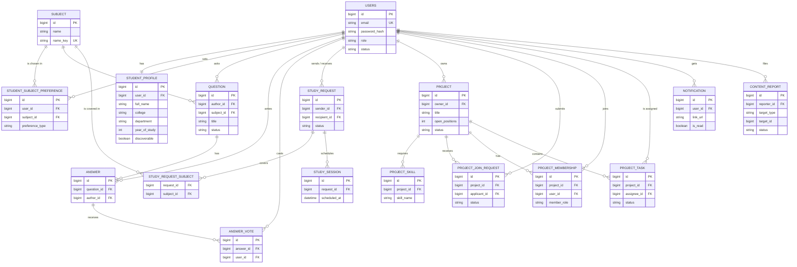

# StudySync database (ER diagram)

Rendered automatically by GitHub and by IntelliJ's Markdown preview (Mermaid).

Database rules that protect data:

- `answer_vote`: unique (answer, user) so one student can vote once per answer.
- `study_request.active_pair_key` and `project_join_request.active_key`: generated columns with a unique index, so duplicate active requests are impossible even if two clicks arrive at the same time.
- `project_membership`: unique (project, user).
- Accounts are suspended, not deleted. Deleting a question deletes its answers and votes.
